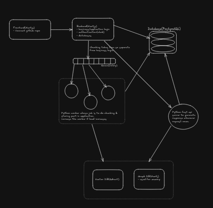
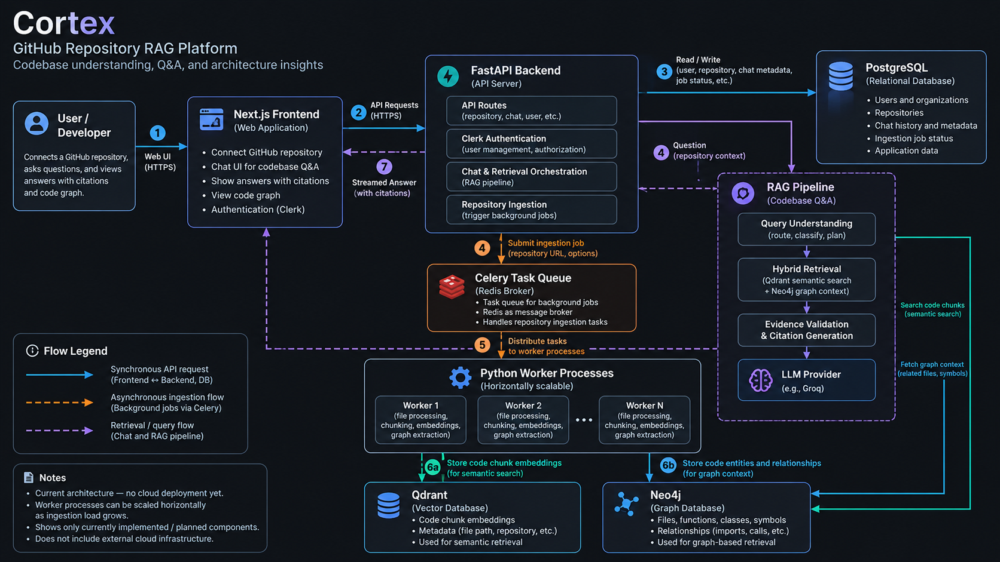

# Cortex: AI-Powered Codebase Intelligence

**Understand unfamiliar codebases. Explore code relationships. Get answers grounded in source code.**

Cortex is a GitHub codebase intelligence platform that combines Retrieval-Augmented Generation (RAG), semantic code search, and graph-based retrieval to help developers understand unfamiliar repositories without manually navigating every file.

It uses **Tree-sitter for syntax-aware code chunking, Qdrant for vector retrieval, Neo4j for code relationships, and LangGraph for AI workflows**, with a focus on verifiable answers backed by file and line citations.

---

## Key Features

- **Repository Ingestion:** Index public GitHub repositories for repository-specific question answering.
- **Syntax-Aware Chunking:** Use Tree-sitter to preserve meaningful code structures during chunking.
- **Semantic Code Search:** Retrieve relevant code using vector embeddings and Qdrant.
- **Graph-Based Retrieval:** Represent code entities and relationships using Neo4j.
- **Context-Aware Q&A:** Use retrieved source code to generate repository-specific explanations.
- **Verifiable Citations:** Provide file and line references to help developers verify answers against the source.
- **Asynchronous Processing:** Use Celery and Redis to separate repository ingestion from interactive requests.

> **Core principle:** Retrieve evidence from the actual codebase before generating an answer.

---

## System Architecture

Cortex separates repository ingestion from question answering, allowing resource-intensive indexing tasks to run independently of interactive queries.

### High-Level Architecture



*The architecture diagram illustrates the relationships between the application backend, background workers, AI services, and storage systems.*

### 1. Repository Ingestion Pipeline

1. **Repository Intake:** Validate the repository request and create an ingestion job.
2. **Asynchronous Processing:** Dispatch background tasks through Celery and Redis.
3. **Code Processing:** Parse source files, create syntax-aware chunks, and preserve source locations.
4. **Embedding Generation:** Generate vector embeddings for semantic code search.
5. **Relationship Extraction:** Extract supported code entities and relationships for graph-based exploration.
6. **Indexing:** Store embeddings in Qdrant and code relationships in Neo4j, while PostgreSQL maintains application metadata and job status.

**Design decision:** Separating ingestion from interactive requests helps isolate expensive processing and provides a path toward independent worker scaling.

### 2. Question-Answering Pipeline

1. **Query Understanding:** Process the developer's repository-specific question.
2. **Evidence Retrieval:** Retrieve semantically relevant code from Qdrant and related code entities from Neo4j when appropriate.
3. **Context Assembly:** Combine relevant source code and relationship information.
4. **Answer Generation:** Use an LLM workflow to generate an explanation grounded in the retrieved evidence.
5. **Source Citations:** Return file and line references so developers can verify the answer.

**Design decision:** Combining semantic retrieval with graph context helps address questions involving relationships across multiple files.

---

## Tech Stack

| Category | Technologies |
|---|---|
| Languages | TypeScript, Python, JavaScript |
| Frontend | Next.js, React, Tailwind CSS |
| Backend | FastAPI, Next.js |
| Database | PostgreSQL |
| Vector Database | Qdrant |
| Graph Database | Neo4j |
| Background Processing | Celery, Redis |
| AI / LLM | RAG, Embeddings, LLM APIs, LangGraph |
| Code Processing | Tree-sitter, AST-based chunking |
| Authentication | Clerk |
| Infrastructure | Docker, Docker Compose |
| Package Management | pnpm, Python packaging tools |

---

## Engineering Decisions

| Challenge | Approach |
|---|---|
| Repository ingestion can be expensive | Process repositories asynchronously using Celery workers |
| Generic text chunking can break code context | Use Tree-sitter for syntax-aware chunking |
| Semantic search may miss structural relationships | Combine vector retrieval with graph-based context |
| LLMs can generate unsupported claims | Ground responses in retrieved source code |
| Answers need to be verifiable | Preserve file paths and line references |
| Repository content can become stale | Associate indexed content with repository revisions as supported by the implementation |

---

## Engineering Priorities

- **Separation of Concerns:** Keep application logic, ingestion, retrieval, and persistence independent.
- **Reliability:** Track ingestion status and handle processing failures explicitly.
- **Retrieval Quality:** Improve evidence retrieval for questions involving multiple files and code relationships.
- **Answer Trustworthiness:** Provide source-backed explanations rather than unsupported claims.
- **Security:** Enforce repository access controls and handle potentially sensitive source code carefully.

These priorities describe the intended engineering approach; implementation status depends on the current codebase.

---

## Repository Structure

```text
cortex-2/
├── web/                     # Next.js frontend
├── api/                     # FastAPI backend and Python core
├── infra/
│   └── docker-compose.yml   # Local infrastructure services
├── docs/
│   └── architecture.md      # Architecture and networking guide
├── .env.example             # Environment variable template
├── RUN_GUIDE.md             # Detailed local setup instructions
└── README.md                # Project overview and quickstart
```

---

## Getting Started

### Prerequisites

- **Node.js:** >= 20.x
- **pnpm:** >= 9.x
- **Python:** >= 3.12
- **Docker & Docker Compose:** v2.20+

### 1. Configure Environment Variables

```bash
cp .env.example .env
```

Configure the required credentials and service settings in `.env`.

### 2. Start Infrastructure

From the repository root:

```bash
docker compose --project-directory . -f infra/docker-compose.yml up -d
```

Check service status:

```bash
docker compose --project-directory . -f infra/docker-compose.yml ps
```

Local services:

| Service | Address |
|---|---|
| PostgreSQL | `localhost:5432` |
| Redis | `localhost:6379` |
| Qdrant REST API | `http://localhost:6333` |
| Qdrant gRPC | `localhost:6334` |
| Neo4j Browser | `http://localhost:7474` |
| Neo4j Bolt | `bolt://localhost:7687` |

### 3. Start the FastAPI Backend

```bash
cd api

python3 -m venv .venv
source .venv/bin/activate

pip install -e ".[dev]"

uvicorn app.main:app --reload --host 0.0.0.0 --port 8000
```

- API: `http://localhost:8000`
- OpenAPI documentation: `http://localhost:8000/docs`
- Health check: `http://localhost:8000/health`

### 4. Start the Next.js Frontend

In a separate terminal:

```bash
cd web

pnpm install
pnpm dev
```

Open `http://localhost:3000`.

For the complete local setup, environment configuration, and terminal commands, see [RUN_GUIDE.md](RUN_GUIDE.md).

---

## Testing and Code Quality

### Python Backend

```bash
cd api
source .venv/bin/activate

pytest
ruff check .
ruff format --check .
```

### Frontend

```bash
cd web

pnpm test
pnpm lint
pnpm build
```

### Infrastructure

```bash
docker compose --project-directory . -f infra/docker-compose.yml ps
```

---

## Project Documentation

- [Architecture Guide](docs/architecture.md): Service responsibilities, networking, and data flows.
- [Local Run Guide](RUN_GUIDE.md): Step-by-step setup and execution instructions.

---

## Project Goal

Cortex explores how AI-powered developer tools can move beyond basic chatbot interactions toward repository-aware code intelligence.

The goal is to make codebase explanations **traceable, context-aware, and verifiable against the source code they describe**.