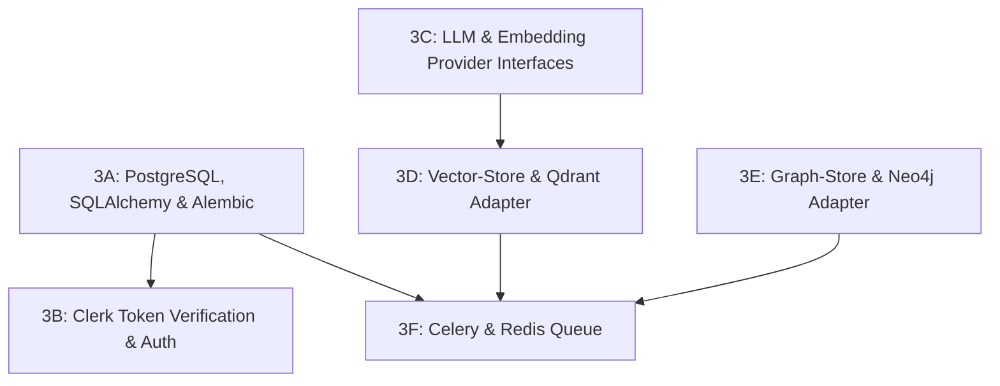

# Phase 3 Implementation Plan — Backend Foundations and Adapters

This planning document establishes the architectural baseline, execution order, dependencies, and file layout for Phase 3 (Subphases 3A through 3F).

---

## 1. Current `api/` State Assessment

The baseline established in Phase 1 provides:
- [`api/pyproject.toml`](../api/pyproject.toml): Runtime dependencies (FastAPI, Uvicorn, Pydantic Settings, HTTPX) and dev dependencies (pytest, pytest-asyncio, ruff).
- [`api/app/core/config.py`](../api/app/core/config.py): Pydantic Settings loading environment configurations for PostgreSQL, Redis, Qdrant, and Neo4j.
- [`api/app/main.py`](../api/app/main.py): FastAPI application entry point with CORS, lifespan handlers, and `/health`.
- Directory skeletons: `domain/`, `services/`, `infrastructure/`, `workers/`, `api/v1/`.
- Infrastructure: Docker Compose containers for PostgreSQL 16, Redis 7, Qdrant, and Neo4j are active and verified healthy.

---

## 2. Subphase Execution Order



1. **Phase 3A — PostgreSQL, SQLAlchemy, and Alembic**:
   Durable schema for repositories, ingestion jobs, conversations, and messages. Foundation for all relational state.
2. **Phase 3B — Clerk Token Verification and Authorization**:
   Server-side JWT signature & claims verification (`sub`, `iss`, `azp`), FastAPI auth dependencies, and resource ownership validation.
3. **Phase 3C — LLM and Embedding Provider Interfaces**:
   Typed interfaces decoupling application code from provider SDKs. Groq chat model adapter and Sentence-Transformers embedding adapter with verified vector dimensions.
4. **Phase 3D — Vector-Store Interface and Qdrant Adapter**:
   Typed vector store interface. Qdrant adapter with collection management, payload schemas, and scoped filtering by repository ID and Git commit SHA.
5. **Phase 3E — Graph-Store Interface and Neo4j Adapter**:
   Typed graph store interface. Parameterized Cypher operations, connection pooling, and scoped graph relationships isolated from future memory models.
6. **Phase 3F — Celery and Redis Queue Foundation**:
   Celery application configuration within the `api/` package, Redis broker connection, task registration, and a non-destructive smoke task.

---

## 3. Subphase Dependencies and Conflict Prevention

| Subphase | Direct Dependencies | Downstream Consumers | Conflict Mitigation |
|---|---|---|---|
| **3A** | PostgreSQL 16 (Local Docker), SQLAlchemy, Alembic | 3B (ownership checks), 3F (job state), Phase 4 (ingestion) | Pure asyncpg/SQLAlchemy; no secondary ORM or Prisma. |
| **3B** | 3A (Owner Clerk ID reference in models), Clerk JWKS | Phase 4 API endpoints, Phase 6 Chat streaming | Validates cryptographic claims (`sub`); never trusts request body user IDs. |
| **3C** | Groq API key (optional for mocked unit tests), Embedding model | 3D (vector dimensions must match embedding output) | Independent abstractions; changing LLM provider never forces re-embedding. |
| **3D** | 3C (embedding vector dimension), Qdrant (Local Docker) | Phase 5 (chunk ingestion), Phase 6 (retrieval) | Payload filtering by repository & commit SHA enforced at interface boundary. |
| **3E** | Neo4j (Local Docker), Neo4j Python Driver | Phase 5 (graph indexing), Phase 7 (Neo4j RAG) | Parameterized Cypher queries; code graph is strictly partitioned. |
| **3F** | 3A (durable job records), Redis 7 (Local Docker) | Phase 4 (background ingestion tasks) | Redis used strictly as broker/transient backend; PostgreSQL owns durable job status. |

---

## 4. Exact File Layout to be Created Under `api/`

```text
api/
├── alembic/                         # Created in 3A
│   ├── env.py
│   ├── script.py.mako
│   └── versions/
├── alembic.ini                      # Created in 3A
├── app/
│   ├── api/
│   │   ├── deps.py                  # Created in 3B (get_current_user, get_db)
│   │   └── v1/
│   │       ├── router.py
│   │       └── endpoints/           # Routes added as subphases complete
│   ├── core/
│   │   ├── config.py                # Extended with provider/auth settings
│   │   └── security.py              # Created in 3B (JWKS, token verification)
│   ├── domain/
│   │   ├── models/                  # Created in 3A (SQLAlchemy models)
│   │   │   ├── base.py
│   │   │   ├── repository.py
│   │   │   ├── job.py
│   │   │   ├── conversation.py
│   │   │   └── message.py
│   │   └── schemas/                 # Pydantic DTOs
│   ├── infrastructure/
│   │   ├── db/                      # Created in 3A (Async engine & sessions)
│   │   │   └── session.py
│   │   ├── llm/                     # Created in 3C (LLM interface & Groq)
│   │   │   ├── interfaces.py
│   │   │   ├── groq_provider.py
│   │   │   └── factory.py
│   │   ├── embeddings/              # Created in 3C (Embedding interface & local model)
│   │   │   ├── interfaces.py
│   │   │   ├── sentence_transformer.py
│   │   │   └── factory.py
│   │   ├── vector/                  # Created in 3D (Vector interface & Qdrant)
│   │   │   ├── interfaces.py
│   │   │   └── qdrant_adapter.py
│   │   └── graph/                   # Created in 3E (Graph interface & Neo4j)
│   │       ├── interfaces.py
│   │       └── neo4j_adapter.py
│   └── workers/                     # Created in 3F (Celery & smoke task)
│       ├── celery_app.py
│       └── tasks.py
└── tests/
    ├── test_health.py               # Existing
    ├── test_database.py             # Created in 3A
    ├── test_auth.py                 # Created in 3B
    ├── test_providers.py            # Created in 3C
    ├── test_qdrant.py               # Created in 3D
    ├── test_neo4j.py                # Created in 3E
    └── test_workers.py              # Created in 3F
```
