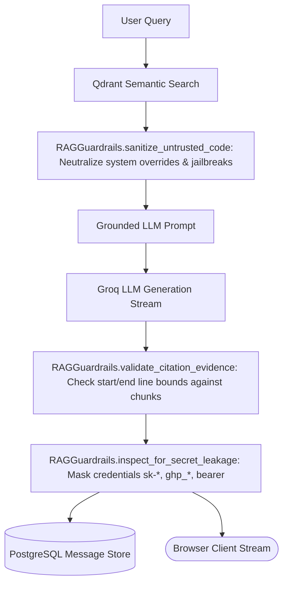

# Phase 7 Implementation & Architecture: Neo4j Code Graph, Mem0, LangSmith, Guardrails, & Hardening

## 1. Overview & Objectives
Phase 7 hardens Cortex for production enterprise operation:
- **Neo4j Code Relationship Graph**: Structural AST graph extraction (Files, Classes, Functions, Methods, and Imports) using Tree-sitter, persisted to Neo4j with deterministic UUIDv5 node IDs and scoped by `repository_id` and `commit_sha`.
- **Mem0 Long-Term Memory**: Bounded, user-scoped memory service backed by Qdrant in a dedicated collection (`cortex_user_memory`), completely isolated from code vectors and graph nodes, with strict credential rejection policies and safe no-op behavior when disabled.
- **LangSmith Tracing & Observability**: Optional, zero-overhead tracing configuration controlled via environment variables and initialized during FastAPI application lifespan, defaulting to disabled.
- **RAG Application Guardrails**: Multi-tier defense-in-depth security layer neutralizing prompt-injection patterns in untrusted code, redacting secret/token leakage in LLM outputs, and validating citation evidence boundaries.
- **Operational Hardening & Recovery**: Production safeguards covering cross-user isolation, database ownership, connection pooling, rate limits, health checks, and backup/recovery strategies.

---

## 2. Code Relationship Graph Architecture

### Schema Definition
All graph entities are stored in Neo4j via the existing `Neo4jGraphStoreAdapter` and `:CodeNode` label:

| Node Type | Properties | Description |
| :--- | :--- | :--- |
| `File` | `file_path`, `repository_id`, `commit_sha` | Top-level source file within the repository |
| `Class` | `name`, `file_path`, `start_line`, `end_line`, `repository_id`, `commit_sha` | Class declaration extracted via AST |
| `Function` | `name`, `file_path`, `start_line`, `end_line`, `repository_id`, `commit_sha` | Module-level function declaration |
| `Method` | `name`, `file_path`, `start_line`, `end_line`, `repository_id`, `commit_sha` | Member method within a class |
| `Import` | `module`, `file_path`, `repository_id`, `commit_sha` | Module or symbol import dependency |

### Relationship Types
- **`CONTAINS`**: `(File)-[:CONTAINS]->(Class|Function|Import)`
- **`DEFINES`**: `(Class)-[:DEFINES]->(Method)`
- **`IMPORTS`**: `(File)-[:IMPORTS]->(Import)`
- **`CALLS`**: Inferred symbol references across functions/methods (distinguished from AST-verified structural definitions).

### Scoping and Authorization
Every node and relationship includes `repository_id` and `commit_sha`. Read and write queries strictly enforce these filters alongside database-level repository ownership checks (verified Clerk subject ID) before exposing graph data.

---

## 3. Mem0 Long-Term Memory Integration

### Version & Technical Findings
- Installed: `mem0ai==2.2.1`.
- Mem0 natively supports vector stores including Qdrant (`mem0.vector_stores.qdrant.Qdrant`).
- In this version, graph memory is not natively wired to Neo4j via standard vector/graph combined stores without external Graphiti or custom providers.
- **Architectural Boundary**: To maintain clean separation of concerns and maximum data integrity:
  1. **Code relationships** are stored in Neo4j via Cortex's Tree-sitter pipeline with `:CodeNode` labels.
  2. **User preferences and memory** are managed via Mem0 in a dedicated Qdrant collection named `cortex_user_memory`.
  3. Memory is strictly scoped by `user_id` (Clerk `sub`).

### Safe Memory Policies
- **Disabled by default**: Controlled via `MEM0_ENABLED=False` in configuration.
- **Credential & Secret Filtering**: Any memory candidate containing API keys (`sk-`, `ghp_`, `gho_`), passwords, private keys, or tokens is rejected before storage.
- **Persistence Source of Truth**: Relational entities (`conversations`, `messages`, `citations`) remain durably stored in PostgreSQL.

---

## 4. LangSmith Tracing & Observability

- **Configuration**:
  - `LANGSMITH_TRACING`: Boolean flag (default: `False`).
  - `LANGSMITH_API_KEY`: API key for LangChain / LangSmith.
  - `LANGSMITH_PROJECT`: Target project name (default: `cortex`).
  - `LANGSMITH_ENDPOINT`: LangSmith REST endpoint (default: `https://api.smith.langchain.com`).
- **Lifespan Initialization**:
  Configured in `api/app/main.py` lifespan handler. If disabled or missing an API key, environment variables are explicitly set to `"false"`.
- **Data Protection**: LangSmith tracing does not log raw repository cloning artifacts or database credentials.

---

## 5. RAG Guardrails

Application-level controls implemented in `api/app/core/guardrails.py`:

1. **Prompt-Injection Neutralization**:
   Untrusted repository files are inspected for patterns attempting to override system behavior (e.g. `ignore previous instructions`, `system prompt:`, `disregard instructions`). Matching phrases are defanged before insertion into the prompt.
2. **Secret Leakage Redaction**:
   Assistant responses are scanned before persistence and streaming completion. Any standard token format (`ghp_`, `gho_`, `sk-`, `Bearer ...`, PEM private keys) is masked with `[REDACTED_SECRET]`.
3. **Citation Evidence Validation**:
   Generated citations (`[filepath#Lstart-Lend]`) are validated against retrieved chunks to ensure line ranges fall within actually fetched code snippets.
4. **Honest Insufficient Evidence**:
   If semantic score is low or retrieved chunks are empty, the workflow halts and informs the user directly without hallucinating.

---

## 6. Operational Hardening & Recovery

- **Connection Pooling**: PostgreSQL connections managed by SQLAlchemy AsyncEngine and Psycopg `AsyncConnectionPool`.
- **Idempotency & Deduplication**: Vector chunks and code graph nodes use deterministic UUIDv5 identifiers based on `repository_id`, `commit_sha`, `file_path`, and byte offsets/symbol names.
- **Isolation Verification**: All endpoints enforce Clerk user subject matching on database models, preventing horizontal privilege escalation.
- **Backup & Disaster Recovery**:
  - **PostgreSQL**: Daily `pg_dump` of relational data (`users`, `repositories`, `ingestion_jobs`, `conversations`, `messages`).
  - **Qdrant**: Snapshot API (`POST /collections/{collection_name}/snapshots`) persisted to S3/blob storage.
  - **Neo4j**: Periodic `neo4j-admin database dump` or Cypher export.

---

## 7. Test & Verification Summary

- **Backend Pytest Suite**: 102 passed, 1 skipped (live Groq opt-in smoke test), 0 failed:
  - Code graph AST extraction (Python classes, functions, methods, imports): PASSED
  - Code graph Neo4j persistence and symbol context: PASSED
  - Mem0 safe policies (disabled by default, credential rejection, cross-user isolation): PASSED
  - RAG guardrails (prompt injection sanitization, secret masking, citation validation): PASSED
  - LangSmith tracing configuration: PASSED
  - Qdrant, Neo4j, PostgreSQL, Celery, and Auth integration tests: PASSED
- **Backend Linting**: `ruff check .` clean with 0 errors.
- **Frontend Vitest Suite**: 17/17 tests passing.
- **Frontend Type Safety**: `npx tsc --noEmit` clean with 0 errors.
- **Frontend Production Build**: `npm run build` completed successfully.
